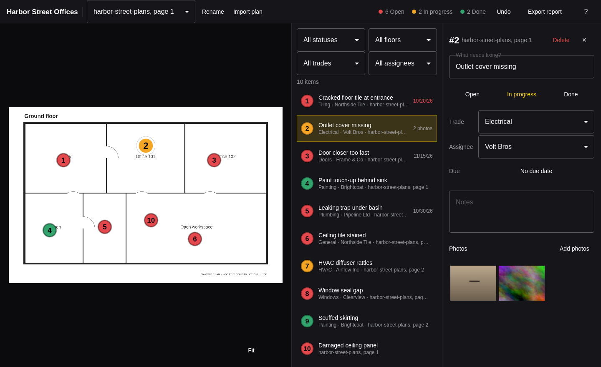

# Corbel

Punch lists on floor plans, for [Omarchy](https://omarchy.org). Open a floor
plan, click where something needs fixing, and track each item from open to
done. When the job is finished, export a closeout report: the item table, every
plan with its pins, and the photos.



- **Pin defects on the plan.** Import a PDF (every page becomes a floor) or an
  image, then click to drop a numbered pin. Drag pins to move them.
- **Track every item.** Title, trade, assignee, due date, notes, photos, and a
  status of open, in progress, or done. Pins are colored by status.
- **Filter the list** by status, trade, assignee, or floor. Selecting an item
  in the list selects it on the plan, and the other way round.
- **Export the closeout report** as a PDF. With a filter set, the report holds
  just those items and their floors, ready to send to one trade or one person.
- **Manage floors.** Rename or delete a floor; deleting one, importing one, and
  renaming one can all be undone.
- **One file per project.** A `.corbel` file is a SQLite database holding the
  plans, items, and photos, so it can be copied or backed up whole. The plans
  and photos you import are never changed.

Corbel follows the Omarchy theme and language as they change.

## Keyboard

| Key | Action |
| --- | --- |
| Space | Pin a defect under the pointer |
| Click | Pin a defect where you click |
| ↑ ↓ or J K | Previous or next item |
| Enter | Edit the title |
| 1 2 3 | Set open, in progress, done |
| P | Add photos |
| Delete | Delete the item |
| Esc | Stop editing, then deselect |
| [ ] | Previous or next floor |
| + − 0 | Zoom in, out, to fit |
| Ctrl + wheel | Zoom at the pointer |
| I | Import a floor plan |
| Ctrl + E | Export the report |
| Ctrl + N / Ctrl + O | New or open project |
| Ctrl + Z / Ctrl + Shift + Z | Undo, redo |
| ? | Show every shortcut |
| Q | Quit |

Changes are saved to the project file as you make them.

## Command line

Every command works on a project without a window, takes `--json`, and exits
0 or 1 with errors on stderr.

```sh
corbel new site.corbel --name "Harbor Street" --plan plans.pdf
corbel plans site.corbel
corbel rename site.corbel 1 "Ground floor"
corbel add site.corbel --title "Cracked tile" --floor 1 --x 0.4 --y 0.6 --trade Tiling
corbel items site.corbel --status open
corbel set site.corbel 3 --status done
corbel export site.corbel closeout.pdf
corbel export site.corbel electrical.pdf --trade Electrical --status open
corbel open site.corbel
```

`corbel skill install` installs a short skill so coding agents know how to use
these commands.

## Build

Needs `qmake6`, `make`, a C++ compiler, Qt 6 (base, declarative, wayland), and
poppler (`pdftoppm`) for PDF plans. All of them come with Omarchy.

```sh
bin/build      # build/corbel
bin/test       # tests, including the real window driven offscreen
bin/install    # builds and installs the package, so Corbel is in the launcher
```

## License

MIT
